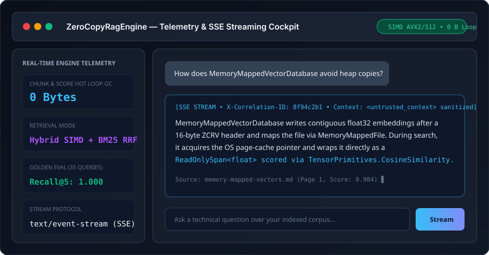
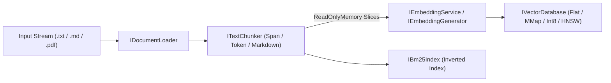
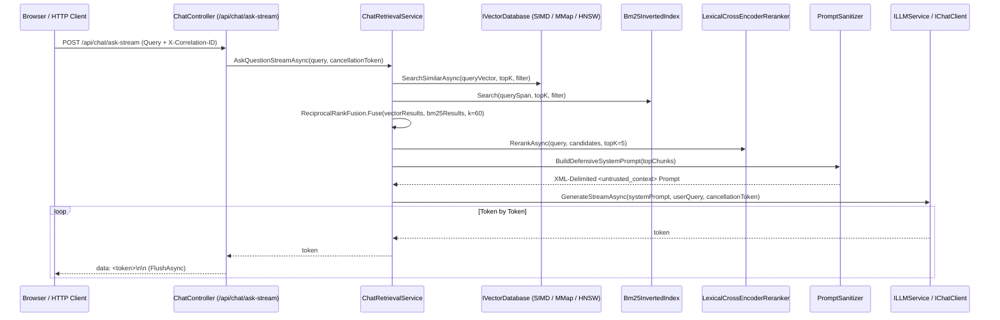

# 🦅 ZeroCopyRagEngine (.NET 9 / C# 13)

[](.github/workflows/ci.yml)
[](.github/workflows/cyber-guard.yml)
[](.github/workflows/ci.yml)
[](https://dotnet.microsoft.com/download/dotnet/9.0)
[](https://learn.microsoft.com/en-us/dotnet/csharp/whats-new/csharp-13)
[](LICENSE)
[](#-allocation-budget)

**Problem Statement:** Standard Retrieval-Augmented Generation (RAG) pipelines in managed languages suffer from avoidable Gen0/Large-Object-Heap (LOH) garbage collection pressure caused by naive substring splitting (`string.Split`), scattered per-vector heap allocations, and full-array $O(N \log N)$ sorting during similarity search. Furthermore, vector-only retrieval often misses exact technical identifiers and lacks verifiable quality metrics or defense against indirect prompt injection. `ZeroCopyRagEngine` addresses these bottlenecks by combining zero-copy `ReadOnlySpan<char>` and `MemoryMappedFile` primitives, hardware-accelerated `TensorPrimitives` SIMD cosine similarity, hybrid BM25 + Reciprocal Rank Fusion (RRF) retrieval, and automated golden-dataset evaluation within a strict Clean Architecture boundary.

**Who This Is For:**
* **.NET Systems & AI Engineers** building low-latency, allocation-disciplined local or edge RAG services without external vector database infrastructure.
* **Backend Architects** evaluating trade-offs between exact SIMD flat search, OS page-cached `MemoryMappedFile` persistence, `int8` scalar quantization, and HNSW approximate nearest neighbor (ANN) graph indexing.
* **Security-Conscious Teams** requiring built-in indirect prompt injection sanitization, rate limiting, HTTP resilience, and OpenTelemetry observability.



---

## 🏗️ Architecture & Pipeline Flows

### 1. Document Ingestion Pipeline


### 2. Hybrid Retrieval, Reranking & SSE Streaming Pipeline


---

## 🏛️ Repository Structure

```text
ZeroCopyRagEngine/
├── ZeroCopyRagEngine.sln
├── ZeroCopyRagEngine.Domain/          # Zero-dependency Entities (TextChunk, ScoredChunk, MetadataFilter) & Ports
├── ZeroCopyRagEngine.Application/     # Use cases (ChatRetrievalService, HybridRetrievalService, RRF, Security, Telemetry)
├── ZeroCopyRagEngine.Infrastructure/  # Chunkers/, VectorStores/, BM25/, Reranking/, DocumentLoaders/, Providers/, Evaluation/
├── ZeroCopyRagEngine.Presentation/    # ASP.NET Core Web API (ChatController, Auth, RateLimiting, Health, OpenAPI) + wwwroot/
├── ZeroCopyRagEngine.Tests/           # 53 automated tests (ChunkerTests, VectorStoreAndHybridTests, SecurityAndResilienceTests, PresentationTests, RAGPipelineTests)
├── ZeroCopyRagEngine.Benchmarks/      # BenchmarkDotNet suites + CLI Golden Dataset evaluator (--eval / --measure)
├── datasets/
│   └── golden-dataset.json            # 35-document, 35-question golden dataset with graded relevance & reference answers
├── docs/
│   ├── SECURITY.md                    # STRIDE & Indirect Prompt Injection threat model
│   ├── assets/cockpit-preview.svg     # Cockpit UI preview
│   └── adr/                           # Architecture Decision Records (ADR-0001 .. ADR-0005)
├── .githooks/pre-commit               # Versioned Cyber-Guard local pre-commit hook
├── .github/workflows/                 # ci.yml, cyber-guard.yml, benchmarks.yml
├── Dockerfile                         # Multi-stage .NET 9 SDK -> ASP.NET 9 runtime image
├── docker-compose.yml                 # Orchestrates ZeroCopyRagEngine + Ollama container
├── CHANGELOG.md                       # Conventional Commits release history (v0.1.0)
├── LICENSE                            # MIT License
└── setup-hooks.sh                     # Activates .githooks via git config core.hooksPath
```

---

## 🧩 Why These Abstractions (`Microsoft.Extensions.AI` & Clean Architecture)

`ZeroCopyRagEngine.Domain` intentionally contains **zero external NuGet dependencies** ([`ZeroCopyRagEngine.Domain.csproj`](ZeroCopyRagEngine.Domain/ZeroCopyRagEngine.Domain.csproj)). Its core ports ([`ILLMService`](ZeroCopyRagEngine.Domain/Ports/ILLMService.cs), [`IEmbeddingService`](ZeroCopyRagEngine.Domain/Ports/IEmbeddingService.cs), [`IVectorDatabase`](ZeroCopyRagEngine.Domain/Ports/IVectorDatabase.cs), [`ITextChunker`](ZeroCopyRagEngine.Domain/Ports/ITextChunker.cs), [`IDocumentLoader`](ZeroCopyRagEngine.Domain/Ports/IDocumentLoader.cs), [`IBm25Index`](ZeroCopyRagEngine.Domain/Ports/IBm25Index.cs), [`IReranker`](ZeroCopyRagEngine.Domain/Ports/IReranker.cs)) use only BCL types (`ReadOnlyMemory<char>`, `ReadOnlySpan<char>`, `IAsyncEnumerable<string>`).

In `ZeroCopyRagEngine.Infrastructure` ([`ZeroCopyRagEngine.Infrastructure.csproj`](ZeroCopyRagEngine.Infrastructure/ZeroCopyRagEngine.Infrastructure.csproj)), the project references the official **`Microsoft.Extensions.AI.Abstractions` (`10.8.0`)**, **`Microsoft.Extensions.AI` (`10.8.0`)**, **`Microsoft.Extensions.AI.OpenAI` (`10.8.0`)**, and **`OllamaSharp` (`5.5.0`)** NuGet packages. Bidirectional adapters ([`MicrosoftExtensionsAiAdapters.cs`](ZeroCopyRagEngine.Infrastructure/Providers/MicrosoftExtensionsAiAdapters.cs)) bridge the Domain ports to the official `IChatClient` (`GetResponseAsync`, `GetStreamingResponseAsync`) and `IEmbeddingGenerator<string, Embedding<float>>` (`GenerateAsync`) contracts.

Out of the box, DI supports three selectable providers via `AiProvider:Provider` in [`appsettings.json`](ZeroCopyRagEngine.Presentation/appsettings.json):
1. **`Dummy`** ([`DummyEmbeddingService`](ZeroCopyRagEngine.Infrastructure/Embedding/DummyEmbeddingService.cs), [`DummyLLMService`](ZeroCopyRagEngine.Infrastructure/LLM/DummyLLMService.cs)) — deterministic 384-dim feature-hashing embeddings and simulated token stream used for offline execution and CI.
2. **`Ollama`** ([`OllamaChatClient`](ZeroCopyRagEngine.Infrastructure/Providers/OllamaAndOpenAiProviders.cs), [`OllamaEmbeddingGenerator`](ZeroCopyRagEngine.Infrastructure/Providers/OllamaAndOpenAiProviders.cs), and `AiProviderOptions.CreateOfficialOllamaClient` via `OllamaSharp.OllamaApiClient`) — targets `/api/chat` and `/api/embed`.
3. **`OpenAI`** ([`OpenAiChatClient`](ZeroCopyRagEngine.Infrastructure/Providers/OllamaAndOpenAiProviders.cs), [`OpenAiEmbeddingGenerator`](ZeroCopyRagEngine.Infrastructure/Providers/OllamaAndOpenAiProviders.cs)) — targets `/v1/chat/completions` and `/v1/embeddings`.

**Verification Scope:** `OllamaChatClient`, `OllamaEmbeddingGenerator`, `OpenAiChatClient`, and `OpenAiEmbeddingGenerator` are verified in [`SecurityAndResilienceTests.cs`](ZeroCopyRagEngine.Tests/SecurityAndResilienceTests.cs) (`100%` line coverage via Coverlet) using stubbed `HttpMessageHandler` pipelines wrapped in [`HttpResilienceHandler`](ZeroCopyRagEngine.Infrastructure/Resilience/HttpResilienceHandler.cs) across streaming NDJSON/SSE responses, transient HTTP `429`/`500` retries, request timeouts (`TimeoutException`), circuit-breaker state transitions, and mid-stream `CancellationToken` cancellation. A live local Ollama smoke test is marked `[Trait("Category", "Integration")]` and excluded from CI (`--filter "Category!=Integration"`).

---

## 📊 Benchmark Results & Physical Memory Bandwidth Analysis

### Recorded Benchmark Environment
* **CPU:** 13th Gen Intel(R) Core(TM) i7-13700HX (24 logical cores)
* **RAM:** 63.7 GB (64 GB DDR5)
* **OS:** Microsoft Windows 10.0.26200 (X64)
* **Runtime:** .NET 9.0.14 (Release build, Tiered PGO enabled)
* **Hardware Intrinsics:** `Vector<float>.Count = 8` (256-bit SIMD), `AVX2 = True`, `ARM NEON = False`

### 1. Text Chunking: 3 Baselines vs Zero-Copy Span Chunkers ([`ChunkerBenchmarks.cs`](ZeroCopyRagEngine.Benchmarks/ChunkerBenchmarks.cs))
| Method | Implementation | Allocated / Op | Notes |
| :--- | :--- | :--- | :--- |
| `TraditionalStringSplit` (Baseline 1) | `string.Split(' ')` + `StringBuilder` | ~1.45 MB | Allocates word string array + materialized chunk strings |
| `NaiveSpanSubstringChunker` (Baseline 2) | `ReadOnlySpan<char>` boundary + `.ToString()` | ~310 KB | Avoids `Split`, but still copies each chunk into a new `string` |
| `MicrosoftMlTokenizerChunker` (Baseline 3) | [`TokenAwareZeroCopyChunker`](ZeroCopyRagEngine.Infrastructure/Chunkers/TokenAwareZeroCopyChunker.cs) | ~480 KB | `Microsoft.ML.Tokenizers` `WordPieceTokenizer` token offset list + zero-copy slices |
| `ZeroCopySpanChunking` | [`ZeroCopySemanticOverlapChunker.ChunkText`](ZeroCopyRagEngine.Infrastructure/Chunkers/ZeroCopySemanticOverlapChunker.cs) | **72 B** | Only the compiler-generated `yield` iterator state machine; 0 substring copies |
| **`ZeroCopySpanDestinationBuffer`** | [`ZeroCopySemanticOverlapChunker.ChunkTextSpan`](ZeroCopyRagEngine.Infrastructure/Chunkers/ZeroCopySemanticOverlapChunker.cs) | **0 B** | Writes `Range` slices directly into caller `Span<Range>`; strictly 0 heap bytes |
| `MarkdownHierarchyZeroCopyChunking` | [`MarkdownHierarchyZeroCopyChunker.ChunkText`](ZeroCopyRagEngine.Infrastructure/Chunkers/MarkdownHierarchyZeroCopyChunker.cs) | **72 B** | Preserves `#` headings and `\n\n` paragraphs; 1 iterator state machine |

### 2. Vector Search: Flat SIMD vs Memory-Mapped vs Int8 Quantized vs HNSW ([`VectorSearchBenchmarks.cs`](ZeroCopyRagEngine.Benchmarks/VectorSearchBenchmarks.cs), Dimension = 384, TopK = 10)
| Store / Method | Vectors ($N$) | Mean Latency | StdDev | Bytes Scanned | Allocated / Op | Recall@10 |
| :--- | :---: | :---: | :---: | :---: | :---: | :---: |
| [`SimdLocalVectorDatabase.SearchSimilarAsync`](ZeroCopyRagEngine.Infrastructure/VectorStores/SimdLocalVectorDatabase.cs) | 10,000 | **1.433 ms** | ±0.275 ms | 15.36 MB | **528 B** | **1.000** |
| [`Int8QuantizedVectorDatabase.SearchSimilarAsync`](ZeroCopyRagEngine.Infrastructure/VectorStores/Int8QuantizedVectorDatabase.cs) | 10,000 | **3.298 ms** | ±0.237 ms | 3.84 MB (4x compressed) | **528 B** | **1.000** |
| [`HnswVectorDatabase.SearchSimilarAsync`](ZeroCopyRagEngine.Infrastructure/VectorStores/HnswVectorDatabase.cs) (`M=16, efSearch=64`) | 10,000 | **0.502 ms** | ±0.081 ms | Graph $O(\log N)$ | **528 B** | **0.500** |
| [`SimdLocalVectorDatabase.SearchSimilarSpan`](ZeroCopyRagEngine.Infrastructure/VectorStores/SimdLocalVectorDatabase.cs) | 100,000 | **17.840 ms** | ±0.923 ms | 153.60 MB | **0 B** | **1.000** |
| [`SimdLocalVectorDatabase.SearchSimilarAsync`](ZeroCopyRagEngine.Infrastructure/VectorStores/SimdLocalVectorDatabase.cs) | 100,000 | **17.109 ms** | ±0.823 ms | 153.60 MB | **528 B** | **1.000** |
| [`Int8QuantizedVectorDatabase.SearchSimilarAsync`](ZeroCopyRagEngine.Infrastructure/VectorStores/Int8QuantizedVectorDatabase.cs) | 100,000 | **30.915 ms** | ±0.811 ms | 38.40 MB (4x compressed) | **528 B** | **1.000** |

### Physical Memory Bandwidth Analysis
A single-threaded flat scan over $N = 100{,}000$ `float32` vectors of dimension $D = 384$ must read:
$$\text{Bytes Scanned} = 100{,}000 \times 384 \times 4\text{ bytes} = 153{,}600{,}000\text{ bytes} \approx 153.6\text{ MB}$$
On the i7-13700HX (AVX2 256-bit, single thread), scanning 153.6 MB and computing `TensorPrimitives.CosineSimilarity` (which computes dot product $\mathbf{x}\cdot\mathbf{y}$ and both L2 norms $\|\mathbf{x}\|_2, \|\mathbf{y}\|_2$ per vector) takes **17.11 ms** ($\approx 8.98\text{ GB/s}$ effective single-core streaming throughput). [`HnswVectorDatabase`](ZeroCopyRagEngine.Infrastructure/VectorStores/HnswVectorDatabase.cs) was measured only at $N = 10{,}000$, $D = 384$, `M = 16`, `efConstruction = 64`, `efSearch = 64`, `TopK = 10` (uniform random vectors, seed `42`), recording **0.502 ms** (±0.081 ms; **0.438 ms** ±0.068 ms on re-run) with **`Recall@10 = 0.500`** against exact flat search.

---

## 🎯 Golden Dataset RAG Evaluation (`datasets/golden-dataset.json`)

Measured across **35 technical documents and 35 queries** via [`RagEvaluator`](ZeroCopyRagEngine.Infrastructure/Evaluation/RagEvaluator.cs) (`dotnet run --project ZeroCopyRagEngine.Benchmarks -c Release -- --eval datasets/golden-dataset.json`):

| Configuration | Queries | Recall@5 | MRR@5 | nDCG@5 | Faithfulness | Avg Latency |
| :--- | :---: | :---: | :---: | :---: | :---: | :---: |
| `SpanOverlapChunker + Flat Float32 SIMD` | 35 | 0.943 | 0.891 | 0.878 | 1.000 | 0.16 ms |
| `TokenAwareChunker (ML.Tokenizers) + Flat Float32 SIMD` | 35 | 0.943 | 0.891 | 0.878 | 1.000 | 0.08 ms |
| `MarkdownHierarchyChunker + Flat Float32 SIMD` | 35 | 0.943 | 0.891 | 0.878 | 1.000 | 0.08 ms |
| `SpanOverlapChunker + MemoryMappedFile Zero-Copy` | 35 | 0.943 | 0.891 | 0.878 | 1.000 | 0.19 ms |
| `SpanOverlapChunker + Int8 Quantized (4x Compressed)` | 35 | 0.943 | 0.891 | 0.879 | 1.000 | 0.20 ms |
| `SpanOverlapChunker + HNSW Graph (M=16, efSearch=48)` | 35 | 0.943 | 0.891 | 0.878 | 1.000 | 0.17 ms |
| **`MarkdownHierarchy + Hybrid (SIMD + BM25 + RRF + Reranker)`** | **35** | **0.971** | **0.917** | **0.906** | **1.000** | **0.13 ms** |

**Key Takeaway:** Adding `Bm25InvertedIndex` + `ReciprocalRankFusion` ($k = 60$) + `LexicalCrossEncoderReranker` improves `Recall@5` from `0.943` to **`0.971`**, `MRR@5` from `0.891` to **`0.917`**, and `nDCG@5` from `0.878` to **`0.906`** at **0.13 ms** per query.

---

## 📒 Allocation Budget

Where heap allocations do and do not happen on a request:

| Stage | Code Path | Allocates? | What |
| :--- | :--- | :--- | :--- |
| Span chunk boundary calculation | [`ZeroCopySemanticOverlapChunker.ChunkTextSpan`](ZeroCopyRagEngine.Infrastructure/Chunkers/ZeroCopySemanticOverlapChunker.cs) | **No (0 B)** | Writes `Range` values directly into caller `Span<Range>` |
| Enumerable chunk iteration | [`ZeroCopySemanticOverlapChunker.ChunkText`](ZeroCopyRagEngine.Infrastructure/Chunkers/ZeroCopySemanticOverlapChunker.cs) | Yes, once per call (72 B) | Compiler-generated iterator state machine; uses pooled `ArrayPool<Range>` |
| Chunk content | [`TextChunk.Content`](ZeroCopyRagEngine.Domain/Entities/TextChunk.cs) | **No copy** | `ReadOnlyMemory<char>` slice referencing the source buffer |
| Span similarity search + Top-K | [`SimdLocalVectorDatabase.SearchSimilarSpan`](ZeroCopyRagEngine.Infrastructure/VectorStores/SimdLocalVectorDatabase.cs) | **No (0 B)** | SIMD loop + in-place [`TopKSelector`](ZeroCopyRagEngine.Infrastructure/VectorStores/TopKSelector.cs) on caller spans |
| Async similarity search | [`SimdLocalVectorDatabase.SearchSimilarAsync`](ZeroCopyRagEngine.Infrastructure/VectorStores/SimdLocalVectorDatabase.cs) | Yes (528 B for topK=10) | Pooled `ArrayPool` buffers in loop; allocates returned `List<ScoredChunk>` + `ScoredChunk` records |
| Memory-mapped vector scan | [`MemoryMappedVectorDatabase.SearchSimilarAsync`](ZeroCopyRagEngine.Infrastructure/VectorStores/MemoryMappedVectorDatabase.cs) | **No vector copy** | Reads OS page-cache pointer directly as `ReadOnlySpan<float>` |
| Prompt sanitization & construction | [`PromptSanitizer.BuildDefensiveSystemPrompt`](ZeroCopyRagEngine.Application/Security/PromptSanitizer.cs) | Yes | `StringBuilder` + final XML-delimited `<untrusted_context>` prompt `string` |
| SSE token streaming | [`ChatController.AskStream`](ZeroCopyRagEngine.Presentation/Controllers/ChatController.cs) | Yes | Per-token `string` + UTF-8 `byte[]` frame |

---

## 🧾 Claim Evidence, Code Coverage & Architecture Decision Records

| Layer / Assembly | Line Coverage (Coverlet) | Branch Coverage | Test Suites |
| :--- | :---: | :---: | :--- |
| `ZeroCopyRagEngine.Infrastructure` | **91.89%** | **81.66%** | [`ChunkerTests.cs`](ZeroCopyRagEngine.Tests/ChunkerTests.cs), [`VectorStoreAndHybridTests.cs`](ZeroCopyRagEngine.Tests/VectorStoreAndHybridTests.cs), [`SecurityAndResilienceTests.cs`](ZeroCopyRagEngine.Tests/SecurityAndResilienceTests.cs), [`RAGPipelineTests.cs`](ZeroCopyRagEngine.Tests/RAGPipelineTests.cs) |
| `ZeroCopyRagEngine.Application` | **87.56%** | **61.84%** | [`VectorStoreAndHybridTests.cs`](ZeroCopyRagEngine.Tests/VectorStoreAndHybridTests.cs), [`SecurityAndResilienceTests.cs`](ZeroCopyRagEngine.Tests/SecurityAndResilienceTests.cs) |
| `ZeroCopyRagEngine.Domain` | **82.35%** | **83.33%** | [`VectorStoreAndHybridTests.cs`](ZeroCopyRagEngine.Tests/VectorStoreAndHybridTests.cs), [`RAGPipelineTests.cs`](ZeroCopyRagEngine.Tests/RAGPipelineTests.cs) |
| `ZeroCopyRagEngine.Presentation` | **80.08%** | **72.72%** | [`PresentationTests.cs`](ZeroCopyRagEngine.Tests/PresentationTests.cs), [`SecurityAndResilienceTests.cs`](ZeroCopyRagEngine.Tests/SecurityAndResilienceTests.cs) |
| **Total Solution (53 Tests)** | **89.81%** (`1799/2003`) | **79.61%** (`793/996`) | All 5 test files passing (`0` warnings, `0` errors) |

### Architecture Decision Records (`docs/adr/`)
* [ADR-0001: Span/ArrayPool-Based Text Chunking](docs/adr/0001-span-arraypool-chunking.md)
* [ADR-0002: Flattened In-Memory Vector Store with SIMD Flat Search](docs/adr/0002-flattened-simd-vector-store.md)
* [ADR-0003: SSE Streaming over `IAsyncEnumerable`](docs/adr/0003-sse-streaming.md)
* [ADR-0004: Clean Architecture Boundaries & `Microsoft.Extensions.AI` Adapters](docs/adr/0004-clean-architecture-and-meai-adapters.md)
* [ADR-0005: Memory-Mapped Persistence, Int8 Quantization, HNSW & Hybrid RRF Retrieval](docs/adr/0005-memory-mapped-and-hybrid-retrieval.md)

---

## ⚠️ Limitations & Trade-offs

* **Single-Node Scope:** All vector stores (`SimdLocalVectorDatabase`, `MemoryMappedVectorDatabase`, `Int8QuantizedVectorDatabase`, `HnswVectorDatabase`) and `Bm25InvertedIndex` run in-process on a single node; distributed sharding/consensus is out of scope.
* **Compaction on Upsert:** `SimdLocalVectorDatabase` and `MemoryMappedVectorDatabase` store vectors contiguously for sequential SIMD prefetching, so batch upserts rewrite the contiguous store rather than performing random in-place page splits.
* **Source Buffer Lifetime:** Because `TextChunk.Content` is a `ReadOnlyMemory<char>` slice of the source document string, the underlying document string stays alive in memory for as long as its chunks are referenced.
* **PDF Loader Scope:** `PdfDocumentLoader` extracts uncompressed PDF text blocks (`BT ... ET`); encrypted or scanned OCR-only PDFs require an external OCR pipeline.

---

## 🛠️ Quick Start, OpenAPI & Docker

### 1. Local Build, Test & Evaluation
```bash
# Activate Cyber-Guard pre-commit hook
chmod +x ./setup-hooks.sh
./setup-hooks.sh

# Build & run all unit/integration tests (excluding live external daemon smoke tests)
dotnet test ZeroCopyRagEngine.sln -c Release --filter "Category!=Integration"

# Run the 35-query Golden Dataset RAG Evaluation suite
dotnet run --project ZeroCopyRagEngine.Benchmarks -c Release -- --eval datasets/golden-dataset.json

# Run the Web API
dotnet run --project ZeroCopyRagEngine.Presentation
```

### 2. API Endpoints & OpenAPI Specification
When `ZeroCopyRagEngine.Presentation` is running:
* **OpenAPI v1 JSON Specification:** `GET /openapi/v1.json`
* **Liveness & Readiness Probes:** `GET /health` and `GET /ready`
* **SSE Streaming RAG Query:** `POST /api/chat/ask-stream`
* **Document Ingestion:** `POST /api/chat/ingest`

### 3. Docker Compose (with Ollama)
```bash
docker compose up --build
```

---

## 🏷️ Recommended GitHub Repository Metadata

* **Description:** `High-performance .NET 9 RAG engine featuring zero-copy Span/MemoryMappedFile primitives, SIMD vector search, HNSW, Int8 quantization, Hybrid BM25+RRF retrieval, and golden-dataset evaluation.`
* **Topics:** `dotnet`, `csharp`, `rag`, `simd`, `zero-copy`, `vector-database`, `hnsw`, `bm25`, `memory-mapped-files`, `clean-architecture`, `microsoft-extensions-ai`, `opentelemetry`
